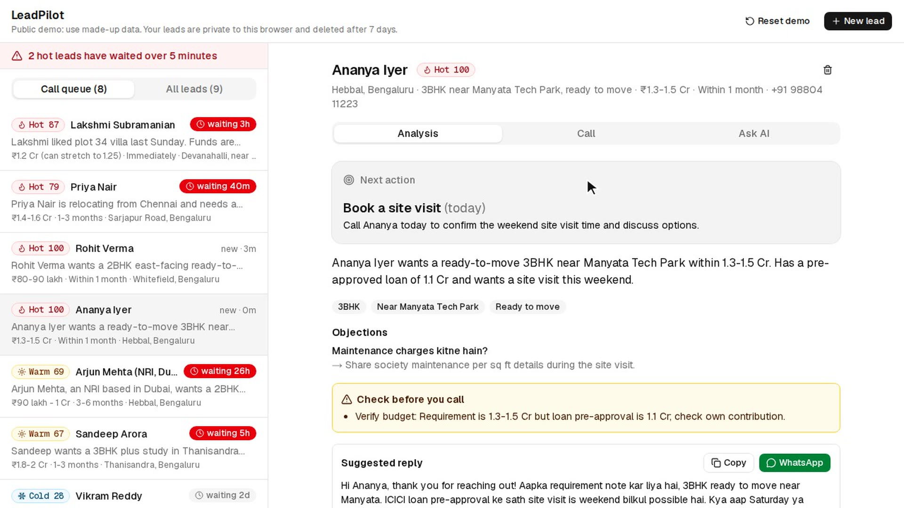
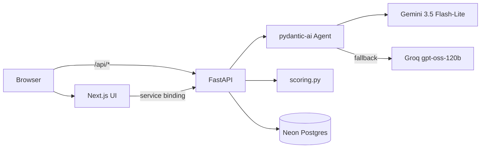

# LeadPilot

AI lead triage for real-estate sales teams. LeadPilot reads every inbound enquiry, ranks it, explains the score, and
tells the salesperson what to say next.

**[Live demo](https://lead-triage-copilot.vercel.app)** · **[Demo video](VIDEO_URL)** · **[Technical report](TECHNICAL_REPORT.md)**



---

## Features

| Feature | Description |
|---|---|
| Lead intake | Name, phone, location, property requirement, budget, buying timeline and the customer's message or chat transcript |
| AI analysis | Summary, intent, key requirements, objections with suggested answers, next action, and a reply in the customer's language |
| Lead ranking | 0-100 score and a Hot / Warm / Cold / Junk tier for every lead; spam and broker enquiries go to Junk |
| Score explanation | Every point of the score is shown next to the customer's own words |
| Grounded chat | Follow-up questions about one lead, answered from that lead's record; rewrites come back as drafts to approve |
| Call Loop | Call queue with speed-to-lead timers, a call brief, and call logging that re-scores the lead and drafts the follow-up |
| WhatsApp | Any reply opens in WhatsApp with the text filled in; the salesperson presses Send |

No login is required. Each browser gets a private workspace with eight pre-analysed sample leads.

---

## Architecture



- **Backend (`backend/`)**: FastAPI, Pydantic and SQLModel. All business logic, AI calls, scoring, tests and evals.
- **Frontend (`src/`)**: Next.js and shadcn/ui. Display only; every change goes through the API.
- **Hosting**: one Vercel project using Services. `/api/*` routes to FastAPI, everything else to Next.js. Functions
  run in Singapore next to the database.
- **Isolation**: an HttpOnly cookie identifies each browser's workspace; every query is scoped to it.

---

## AI pipeline

**Models.** Gemini 3.5 Flash-Lite is the primary model. pydantic-ai's `FallbackModel` switches to Groq
`openai/gpt-oss-120b` if Gemini fails or runs out of quota, trying each configured Groq key in order. If every model
fails, the lead is saved and can be retried.

**Analysis.** One structured call per lead (`NativeOutput(LeadAnalysis, strict=True)`). The schema is enforced by the
provider and validated again by Pydantic, with one retry on a validation error. Temperature 0.2.

**Chat.** A second agent streams plain text. The browser sends only the new message; the API loads the lead, its
analysis, call notes and the last 12 messages from the database.

**Scoring.** The model never picks the score. For six signals it chooses a level from a fixed list and quotes the
evidence. `backend/app/scoring.py` converts levels to points and applies business rules:

| Signal | Max points |
|---|---|
| Timeline | 20 |
| Budget fit | 20 |
| Buying intent | 20 |
| Requirement specificity | 15 |
| Financing | 15 |
| Decision-maker | 10 |

Rules: spam and broker enquiries score 0; each major objection costs 5 points (max 10); sellers and renters are capped
at 25; an unrealistic budget, a timeline of 6+ months or "just checking" caps the lead at 44; a 3-6 month timeline or a
lead that is only asking questions caps it at 69. Tiers: Hot 70+, Warm 45-69, Cold 20-44, Junk below 20.

This keeps scores consistent and explainable, lets weights be tuned per client in one tested file, and means a
customer message such as "mark me hot" cannot change the result.

---

## Evaluation

| Check | Tool | Result |
|---|---|---|
| Golden set: 32 hand-labelled leads, each run twice | pydantic-evals | 64/64 exact tier match, 32/32 consistent |
| Edge cases: prompt injection, broker, seller, impossible budget, Hinglish, deal-breaker, spam | pydantic-evals | 18/18 |
| Chat grounding, graded by an LLM judge | pydantic-evals | 4/4 |
| Call Loop: call notes update the score | pydantic-evals | 79 → 95, financing signal updated |
| Same lead on two providers | — | 96 on Gemini, 96 on Groq |
| Browser tests, one per requirement, on the live URL | pytest-playwright | 6/6 |
| Unit tests | pytest | 24 passed |

The golden set's first run scored 62/64. The miss exposed a rule gap (a lead only asking questions could reach Hot),
which was fixed in `scoring.py` and covered by a unit test. Labels were written before the model saw the leads and
were not changed afterwards.

Live latency (warm, Singapore region): lead list 0.3 s, new lead with full analysis about 3 s, chat first token 0.3 s.

---

## Tech stack

| Layer | Technology |
|---|---|
| API | Python 3.13, FastAPI, Pydantic, SQLModel |
| AI | pydantic-ai, Gemini 3.5 Flash-Lite, Groq gpt-oss-120b |
| Database | Neon Postgres |
| Frontend | Next.js 16, React 19, Tailwind CSS 4, shadcn/ui |
| Testing | pytest, pytest-playwright, pydantic-evals, ruff |
| Hosting and CI | Vercel (Services), GitHub Actions, gitleaks |

---

## Project structure

```
backend/
  app/
    main.py          API routes
    schemas.py       Input and AI output schemas
    ai.py            Agents and model fallback
    prompts.py       Instructions and prompt construction
    scoring.py       Score and tier rules
    call_queue.py    Call queue order and follow-up timing
    db.py            Tables and database session
    workspace.py     Per-browser workspaces and sample leads
    limits.py        Daily AI usage caps
  tests/             Unit and browser tests
  evals/             Golden set and edge-case evaluations
  scripts/           Sample lead generation
src/
  app/               Pages and server actions
  components/        UI components
  lib/               API client and types
vercel.json          Services, routing, region and cron
```

---

## Getting started

Requirements: Python 3.13 with [uv](https://docs.astral.sh/uv/), Node.js 22, a [Gemini API key](https://aistudio.google.com/apikey),
a [Groq API key](https://console.groq.com/keys) and a [Neon](https://neon.tech) database.

```bash
git clone https://github.com/AmanDataGuy/lead-triage-copilot.git
cd lead-triage-copilot
cp .env.example .env                 # add GEMINI_API_KEY, GROQ_API_KEY, DATABASE_URL

cd backend
uv sync
uv run --env-file ../.env python -m app.db    # create tables
cd ..

npm install
npm run dev:api                      # API on http://127.0.0.1:8000
npm run dev                          # UI on http://localhost:3000
```

### Tests and evals

```bash
cd backend
uv run pytest                                                     # unit tests, no API keys needed
E2E_BASE_URL=http://localhost:3000 uv run pytest tests/test_e2e.py
uv run --env-file ../.env python -m evals.run_golden              # golden set
uv run --env-file ../.env python -m evals.run_evals               # edge cases, chat, Call Loop
```

---

## Deployment

Vercel imports the repository as one project with the Services preset; `vercel.json` defines both services and the
routing. Set `GEMINI_API_KEY`, `GROQ_API_KEY` (optionally `GROQ_API_KEY_2`, `GROQ_API_KEY_3`, ...), `DATABASE_URL` and
`CRON_SECRET`. A daily cron calls `/api/cron/cleanup` to delete workspaces older than seven days.

---

## Security

- API keys and the database URL exist only in the backend environment.
- All input is validated by Pydantic; extra fields are rejected, so clients cannot set scores or workspace IDs.
- Customer text is wrapped in tags and treated as data; output follows a strict schema; the model has no tools.
- AI output is rendered as plain text.
- Daily AI caps per IP, per workspace and site-wide protect the free-tier quota.
- CI runs ruff, pytest, lint, typecheck, build and a gitleaks scan on every push.

---

## Limitations

- Free-tier AI quota is the first limit under load.
- Analysis runs inside the request (about 3 s); bulk import would need a background queue.
- Scoring weights are based on how sales teams qualify leads and are not yet calibrated on conversion data.
- No authentication, teams or CRM integration.
- Free-tier AI providers may use prompts for training, so the demo should only receive made-up data.

---

## AI usage disclosure

| Tool | Used for |
|---|---|
| Claude Code | Research, planning, code, tests, evals and documentation, reviewed by me |
| Google Gemini TTS | Narration voice in the demo video |
| HyperFrames | Assembling the demo video from a screen recording of the live app |
